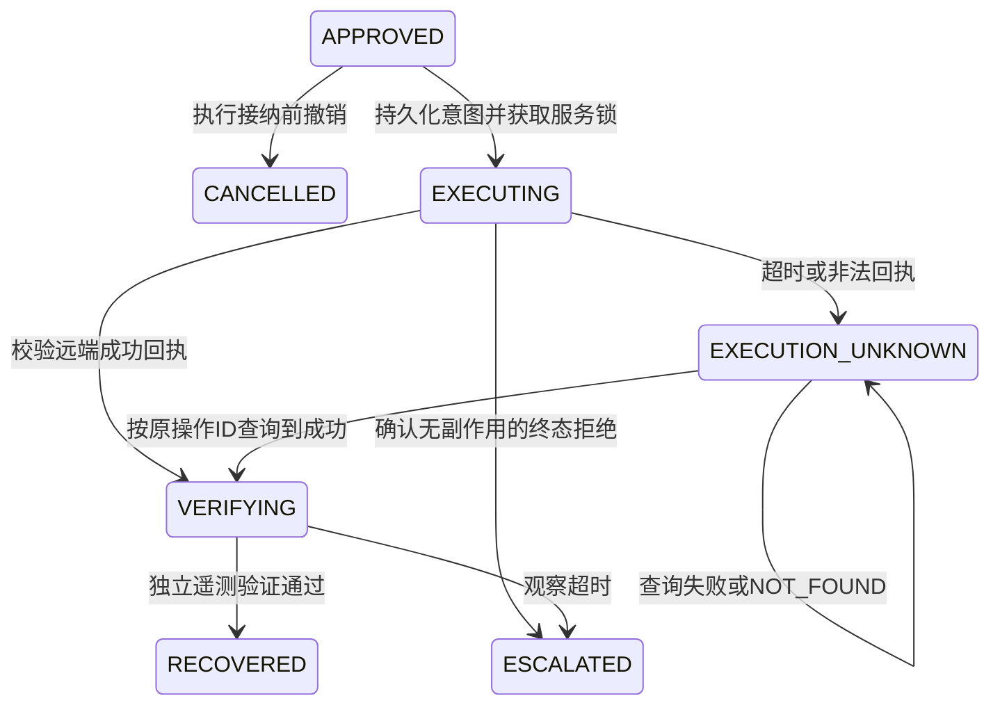

# v0.2：跨系统执行、对账与并发处置

这一版把“远端动作”和“本地事件状态”拆开，实现无法使用单一数据库事务时的故障恢复。当前发布端仍然是模拟器，但它使用独立数据库；测试会真实终止子进程，验证动作与状态之间的崩溃窗口。

## 执行协议



`Engine.dispatch()` 先在本地事务中完成审批/策略/版本校验、获取服务锁，并记录 `EXECUTION_PREPARED`。事务提交后才调用适配器。操作 ID 为 `sha256(incident_id + plan_hash)`；请求摘要和适配器 ID 同时持久化。

只要某事件已有执行意图，再次调用 dispatch 就返回现状，**不会再发送操作**。这意味着“提交前进程死亡”也不会直接重发，需进入对账/人工处理。当前实现以保守停机换取明确的执行边界，不是具备自动重试的一般任务队列。

`Engine.reconcile()` 只调用 `lookup(operation_id)`。它在审批过期或 kill switch 开启时仍可运行，因为查询已发出操作的结果不会产生新写入。远端结果必须匹配操作 ID、请求摘要、目标版本、执行模式和完成时间。

适配器协议：

```python
class DeploymentAdapter(Protocol):
    adapter_id: str  # 重启后稳定，不能换后端后继续查询原操作
    mode: str
    def submit(self, operation_id: str, request: dict) -> dict: ...
    def lookup(self, operation_id: str) -> dict: ...
```

| 结果 | 语义 | 本地处理 |
|---|---|---|
| SUCCEEDED | 操作已完成，回执绑定请求与目标版本 | 进入 VERIFYING，不直接确认业务恢复 |
| REJECTED | 终态拒绝，服务端保证无副作用、不会稍后执行 | 升级人工并释放服务锁 |
| PENDING | 已接受、尚未完成 | 保持 EXECUTING 和服务锁 |
| NOT_FOUND | 查询尚未找到记录，不能排除原请求仍在传输/处理 | 保持未知与服务锁，不重发 |
| 超时/非法返回 | 无法可信判断结果 | 保持未知与服务锁，不泄漏后端异常正文 |

重复或延迟返回不能把 VERIFYING/RECOVERED 降回未知。独立发布模拟器在服务端事务内检查操作幂等键、请求一致性、版本前置条件、目标版本、流量比例和执行截止时间；这模拟了未来发布平台必须提供的能力。

## 服务锁与审批撤销

`service_locks` 以完整五元作用域为键，在同一数据库中约束不同故障事件的处置。锁覆盖执行及恢复观察期，而不仅是发送请求的一瞬间。原有 `execute()` 单事务模拟路径也遵守此锁，避免通过旧入口绕过。

恢复确认后释放锁。远端明确 REJECTED 且无副作用也释放锁。结果未知或验证超时则保留锁，防止下一个事件继续对同一服务试错。锁不会自动超时释放；当前没有人工解锁 API，需要后续引入带远端终态/取消证明的恢复流程，不能简单删除锁行继续执行。

这是共享 SQLite 实例内的持久化互斥，并非已完成的跨区域分布式租约。生产仍需 PostgreSQL/工作流协调、fencing token、操作取消/终态证明及人工接管协议。

`revoke_approval()` 在 AWAITING_APPROVAL/APPROVED 时，将事件置为 CANCELLED 并记录操作者、原因、方案哈希。它与执行接纳通过数据库事务串行化：先撤销则不能执行；先接纳则撤销返回明确拒绝，不能声称远端已取消。kill switch 同样只阻止新的接纳，不保证取消已经接纳的请求。

## 恢复必须独立验证

远端成功回执不会修改本地遥测中的版本或错误率。即使指标健康，遥测仍显示旧版本时也不能确认恢复。演示通过显式的后续模拟观测更新版本；生产必须由真实只读连接器提供。

恢复验证使用已审批方案保存的 Runbook 门槛。全局策略升级后，已执行事件不会突然换一套成功条件。新执行仍会核对当前策略版本，失效方案不得继续使用。

Agent 接收的是独立证据副本，防止某个推理实现意外修改其他角色的输入和后续审批摘要。该边界防止进程内引用污染，不替代对模型幻觉和提示注入的评估。

## 运行演练

```powershell
# 远端完成，但响应丢失：未知 → 重启 → 对账成功 → 验证恢复
python -m mttr_guard --simulate-approval --fault after_submit

# 请求没有送达：查不到不等于可以重发，保留未知和服务锁
python -m mttr_guard --simulate-approval --fault before_submit

# 保留原有单事务模拟方式，便于比较故障边界
python -m mttr_guard --simulate-approval --execution-mode atomic

python -m unittest discover -s tests -v
```

默认执行演示现在使用独立发布模拟器。加 `--db artifacts/drill.db` 时，本地事件库为该路径，发布端数据库为 `artifacts/drill.db.deployment.db`；不传 `--db` 时两者正常退出后均清理。

## 实际验证与仍缺少的能力

新增测试覆盖：独立远端幂等/版本 CAS、响应丢失、提交前及远端提交后的真实子进程退出、重启对账、同服务并发接纳、重复 dispatch、查询失败/NOT_FOUND、回执篡改、延迟结果、审批撤销和固定恢复策略。

真实子进程退出验证了应用进程崩溃场景，不等于宿主机断电、磁盘故障或远端网络协议测试。当前适配器只允许 SIMULATED 模式，避免模拟证据误驱动真实系统。没有添加真实发布凭据、HTTP 服务或实际线上写入。

后续生产接入应实现同一协议，并补上身份认证、可靠调度、只读遥测、取消/人工解锁与系统级演练。工作流重试仍需应用侧幂等处理；可参考 [Temporal 的 Activity 重试说明](https://github.com/temporalio/documentation/blob/main/docs/design-patterns/fixed-count-retries.mdx)。
