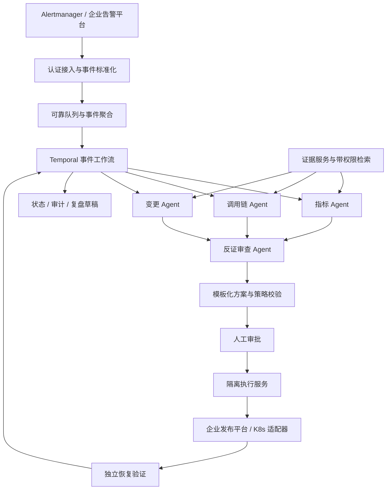

# 企业落地方案

## 1. 产品定义与首期边界

**项目定位：面向 SRE 的发布故障协同处置平台。** 告警到达后，系统把多源证据组织成可追溯的故障假设与止血方案，值班工程师可在同一事件中完成核对、审批、执行跟踪和恢复确认。

目标用户：业务 on-call、服务 Owner、SRE、发布平台团队。业务入口可以是飞书事件卡片和现有故障平台，但核心流程不依赖聊天消息的顺序，也不能依赖故障业务本身运行。

首期选择一个业务团队、5–10 个非支付核心的无状态微服务，覆盖灰度发布后错误率/P99 回归。其他可规划的场景是配置回退、单实例摘流和受限扩容，每类场景必须独立定义 Runbook、权限及验收，不能因“回滚已验证”而自动取得其他执行权限。

第一阶段不执行数据库写入/数据回退、全机房切流、全局重启和权限变更。对这些故障仍可收集证据并交给对应负责人。

**实际需要压缩的时间段：** 找到故障归属、收齐证据、选定止血操作、核对可执行条件、确认恢复。模型能更快生成文字只是局部指标，不能替代用户影响时长。

## 2. 示例事件：checkout 灰度错误率上升

以下数据均为设计示例，而非真实事故或实测结果。

1. checkout 的 r42 接入 5% 灰度流量，3 分钟后灰度错误率达到 18%，稳定版本仍为 0.2%。
2. Receiver 验证来源身份与业务作用域，以服务、环境、集群、发布版本和时间关系聚合告警；原型目前只做单告警 episode 去重。
3. 指标角色比较灰度/稳定流量；调用链角色定位失败 span 并检查下游；变更角色核对 r42/r41、发布时间、迁移标记、Owner。
4. 反证角色检查“共同下游故障”“稳定版本也恶化”“低流量统计不可信”等替代解释。不能仅因发布相邻就认定因果关系。
5. 若证据支持灰度特有回归且 r41 兼容，规划器从批准的 Runbook 模板生成 r42→r41 的灰度回退建议。模板、目标、范围、策略版本、证据摘要一并固化。
6. on-call 审批准确方案；执行服务重新验证权限、版本、流量比例与证据时效，使用发布平台 API 提交。
7. 独立验证器观测版本收敛、错误率、延迟、有效流量与业务成功率。成功则确认恢复；超时或恶化则升级人工，停止继续自动试错。
8. 时间线自动整理为复盘草稿；真正根因由后续验证确定。客户沟通和外部报告由有权限的人员负责。

## 3. 生产目标架构

数据采集优先复用企业现有指标、日志、链路和发布平台。已有 OTel 时，通过 Collector 处理和导出遥测；Collector 本身不是业务根因分析引擎。[OpenTelemetry Collector](https://opentelemetry.io/docs/collector/)

工作流采用 Temporal，持久化等待、重试和事件过程；状态检索用 PostgreSQL，原始证据快照进入对象存储。模型调用和外部工具访问放在 Activity 内，模型结果记录后再供工作流决策使用。工作流恢复能力不等于外部副作用“恰好执行一次”，执行端仍须幂等与对账。[Temporal 文档](https://docs.temporal.io/)

首期生产可使用一条已有可靠消息通道，不必为了技术栈完整再部署多套队列。Redis 可以做缓存，但不能成为审批、执行或恢复状态的唯一依据。

## 4. Agent 分工与协作协议

| 角色 | 输入与工具范围 | 输出 | 对 MTTR 的预期贡献 |
|---|---|---|---|
| 指标分析 | 授权的服务/版本/区域时间序列 | 异常范围、对照差异、样本量、证据 ID | 减少查多个监控面板 |
| 调用链分析 | 相关 trace 摘要、错误模式、依赖拓扑 | 失败位置、下游解释、缺失数据 | 缩短跨服务定位 |
| 变更分析 | 发布、配置、实验变更及版本兼容信息 | 时间相关性、受影响版本、回退限制 | 缩短变更排查 |
| 反证审查 | 前三者结果和独立证据引用 | 矛盾、替代假设、是否允许生成候选方案 | 减少错误处置及返工 |

Incident Coordinator、策略引擎、执行器和验证器采用确定性程序。只有解释非结构化证据和构建假设的环节需要模型。复盘写作 Agent 属于后续能力，不处于止血关键路径。

生产中的每个诊断输出包含：`agent_run_id、incident_id、generation、role、hypothesis、supporting_evidence_ids、contradicting_evidence_ids、missing_information、next_read_query、model_version、prompt_version、elapsed_ms、token_usage`。原型精简为角色、判定、引用与摘要。

共享的是结构化证据板和假设状态，不是无限增长的聊天记录。原始日志中的文本一律视为不可信数据；跨 Agent 输出也不能提高权限。取证工具强制注入作用域，限制时间范围、结果行数、查询成本、并发量与允许的查询模板。

第一轮按可独立获取的证据并行执行，审查在汇合后运行。生产可最多补充一轮取证；达到时间/成本预算、来源不一致或重要依赖缺失就转人工。模型自报置信度不直接决定执行权限。

**为什么需要多 Agent：** 不同证据源可以并行，隔离上下文可以减少无关材料，独立反证有机会纠正单一路径。但多个角色共用同一模型可能出现相关性错误，反证并不天然独立；必须与同工具、同预算的单 Agent 对照。

## 5. 证据与知识服务

证据对象采用统一五元作用域：`tenant / environment / cluster / namespace / service`，外加 cohort、版本、时间窗口和来源。执行对象的作用域必须与所有授权及审批一致。服务拓扑和 Owner 来自 CMDB/服务目录，而不是模型猜测。

指标查询先比较实例/版本/区域维度的异常起点，保留分子、分母及时间范围，避免只保存“错误率 18%”。trace 采样需记录采样策略与覆盖率；没有 trace 不等于没有错误。变更数据需包含代码、配置和实验开关，不能只检查部署版本。

Runbook 知识检索按服务、环境、版本和有效期过滤，再结合关键词/向量召回及重排。历史事故可支持假设，不能覆盖当前观测。Runbook 必须有 Owner、审核版本、前置条件、风险、回退/补偿方式和最近演练记录；失效或无 Owner 的文档只作为参考。

每份证据记录 query template ID、固定查询参数、查询时间、数据时间窗、有效期、结果哈希、截断情况。生产证据存储应先脱敏并加访问控制，默认不把原始用户数据送给模型。

## 6. 安全执行和故障恢复

**执行方案必须不可漂移。** 审批绑定 `incident_id + plan_hash + scope + action + arguments + expected_revision + target_revision + runbook_version + policy_version + evidence_digest + expiry`。任何相关项变更都必须生成新方案。授权来自验证过的企业身份和服务归属，不接受请求体中的 role 字段。

审批以事件方式恢复工作流，回调需验签、过期和防重放。执行端检查审批未撤销、凭据仍有效、发布无新版本、前置条件成立。高风险动作可要求两人审批；首期所有写入要求人工审批。

执行器只接受类型化操作，例如 `rollback_canary`，不接受任意 shell、SQL 或模型生成的 kubectl。策略可由 OPA 管理，权限包括业务域、环境、服务、操作类别、时段与影响范围。[OPA 策略文档](https://www.openpolicyagent.org/docs/policy-language)

Kubernetes 回滚需依赖存在的历史 revision，并结合应用/数据兼容性；部署版本回退不能自动撤销数据迁移。[Kubernetes Deployment 文档](https://kubernetes.io/docs/concepts/workloads/controllers/deployment/)

**副作用故障窗口：** 发布平台已经接受操作，执行 worker 却在写回状态前崩溃。重启后先按操作 ID 查询远端状态；确认未执行才允许同幂等键重试。状态不明时进入 `EXECUTION_UNKNOWN`，禁止换 key 盲目重试。若远端无法支持幂等和版本前置条件，这个动作只能做建议或人工执行。

同一服务同一环境允许一个处置动作处于执行/观察期，使用持久化租约与 fencing token 防止旧 worker 继续写入。事件工作流锁不能代替跨事件的服务动作锁。

具备全局和业务域 kill switch、最大动作次数、冷却期、人工接管与凭据撤销。执行完成后指标未好转，不能自动无限尝试重启/扩容/回滚；需再次诊断并重新审批。补偿也可能有风险，必须事先在 Runbook 中定义。

## 7. 验证规则

生产恢复确认使用多个连续窗口，例如连续 3 个 1 分钟窗口满足门槛；这是需要按业务校准的起始配置。确认条件包括：版本 rollout 已完成、错误率回落、P99 满足服务目标、流量足够、交易/业务成功率恢复、关键下游未进一步恶化。

低请求量、指标缺失、采样变化和 telemetry 延迟均不能自动判定健康。使用端到端业务指标防止通过丢弃请求“改善错误率”。稳定组比较需注意共享依赖和流量分配引入的偏差。

原型只验证间隔 30–60 秒的三个合成样本，不代表完整生产 SLO 窗口；模拟恢复时间不可拿来报告业务收益。验证定时器在生产工作流中持久化，原型由调用者主动调用 `verify`。

## 8. 容量、成本与平台自身可靠性

示例容量假设：告警风暴 1,000 条/分钟，完成合法去重/聚合后 20 个待调查事件/分钟。每事件 4 次模型请求、平均每次 8 秒，则平均模型请求并发约 `20 × 4 × 8 / 60 ≈ 10.7`。并发 24 可作为试压起点，不能据此承诺 SLA；若平均耗时变为 20 秒，则平均需求已达到约 26.7。

输入预算示例：每事件总输入 24k token、总输出 2k token，成本为 `24,000 × 输入单价 + 2,000 × 输出单价`，统一换算计价单位。是否使用较小模型、缓存和补充查询应由故障集评估决定，而不是默认所有 Agent 使用最贵模型。

对租户设公平队列和并发上限，对 P0/P1 保留资源。风暴期间先去重、按影响排序，避免每条告警触发一次模型调用。平台统计排队时间、取证延迟、模型超时、预算耗尽、审批等待、动作失败和验证延迟。

平台自身采用独立运维域、跨故障域部署、短超时、后端熔断、只读降级和人工入口。模型不可用时保留监控链接、Owner、时间线和标准 Runbook；不能阻塞值班响应。生产工作流服务需有备份恢复、升级回放、灾备演练和容量验证。

## 9. 8 周试点与责任人

前提：有现成监控/发布 API、身份服务、试点业务 Owner 和故障回放数据。建议至少 1 位 SRE Owner、2 位后端/平台工程师和共享模型评测资源。以下是排期建议，不是无条件交付承诺。

| 阶段 | 工作与责任 | 退出条件 |
|---|---|---|
| 第 1–2 周 | SRE/业务 Owner 定义场景、SLO、历史基线；平台工程师接只读证据 | 服务作用域与证据可追溯，完成基准数据清洗 |
| 第 3–4 周 | 平台/模型工程师接工作流、四角色分析与影子评估 | 拒绝/降级路径通过，和单 Agent/规则基线完成初步比较 |
| 第 5–6 周 | 发布团队提供幂等与 CAS；接企业审批，staging 故障演练 | 重试、崩溃、超时、版本漂移和人工接管均验证 |
| 第 7–8 周 | 一个业务组开启人工批准的灰度动作，持续记录数据 | 达到预先约定的安全和收益门槛，否则保持影子模式 |

全量自动执行需按单个 Runbook 逐项授权，不能在试点成功后直接放开全部场景。流量比例小也不自动等于业务风险低，支付、资金和关键状态服务须单独评审。

## 10. 当前原型的明确限制

核心示范了协作、策略与状态约束，但尚无线上数据连接器、网络身份认证、实际审批 UI、Temporal 调度、分布式锁、真实发布执行、不可改写审计和生产可用性保障。当前告警去重不包含跨告警聚合；没有生产负载压测，也没有多 Agent 优于其他基线的实测结果。

已持久化的审批/执行状态可以通过核心继续推进；停在诊断阶段可重新调用诊断，版本号阻止旧诊断覆盖新一轮结果。原型不会主动重启 worker、自动扫描超时事件或自动对外通知。生产化必须按照接入契约实现这些能力后再上线。
